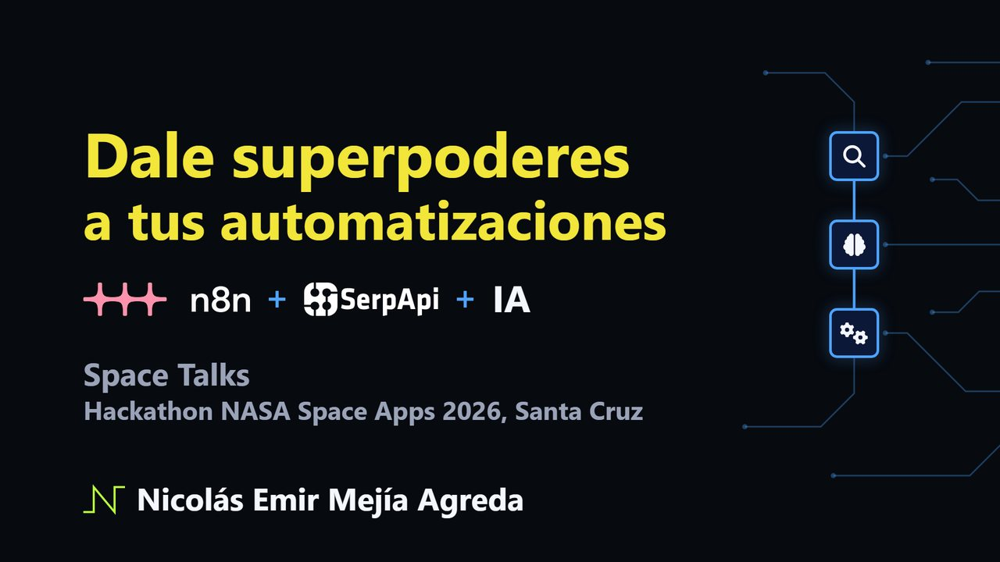
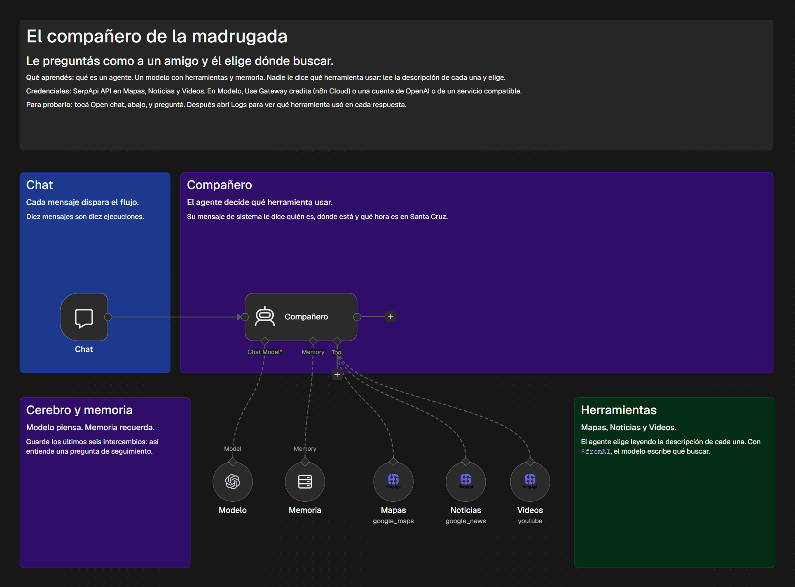
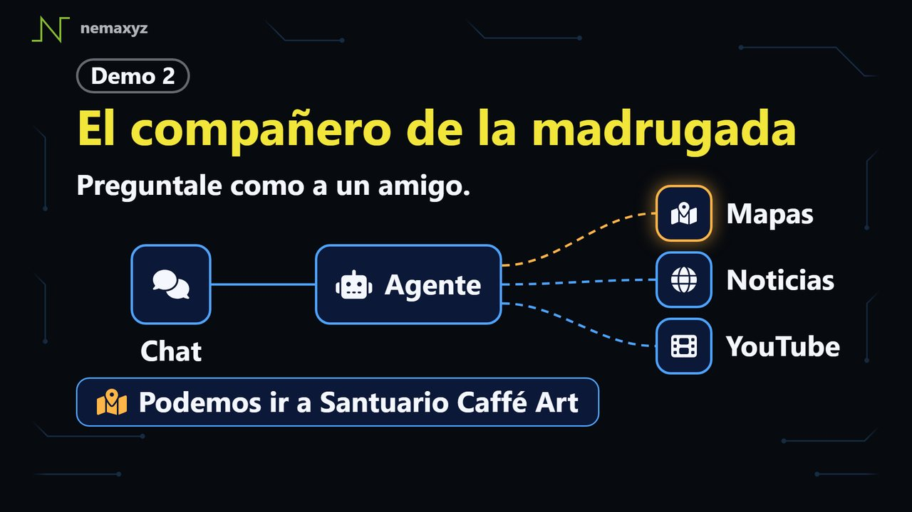

# Dale superpoderes a tus automatizaciones: n8n + SerpApi + IA



Este es el repositorio de mi charla en las **Space Talks**, la Conferencia 2 del Hackathon NASA Space Apps 2026, que organizó NASA Space Apps Santa Cruz ([el evento](https://spaceappssantacruz.web.app/)). Fue el sábado 14 de noviembre de 2026 en el Campus UCB de Santa Cruz de la Sierra, Bolivia, con el hackathon ya en marcha.

Si estuviste en la sala, acá está todo lo que viste: los cuatro flujos de n8n listos para importar, la presentación, los videos y lo que usé para armarla. Si no estuviste, también sirve: cada flujo tiene su guía y las respuestas reales de cuando lo probé.

La idea de la charla entra en una frase: **que el flujo vea, piense y haga.** Una automatización común solo hace. Con SerpApi ve lo que pasa en internet en este momento, con un modelo de IA piensa qué hacer con eso, y n8n hace el resto.

## Qué hay adentro

| Carpeta | Qué tiene |
|---|---|
| [workflows/](workflows/) | Los cuatro flujos en JSON, su guía paso a paso ([workflows/README.md](workflows/README.md)), la especificación nodo por nodo, las muestras reales de las pruebas y las capturas |
| [presentacion/](presentacion/) | La presentación en HTML (un solo archivo que anda sin internet), en PowerPoint con las notas, en PDF para proyectar y en PDF con la fuente de cada dato |
| [videos/](videos/) | El video de cada diapositiva y la charla entera de corrido |
| [contenido/](contenido/) | El guion con lo que se dice en cada paso, el deck del que salen las diapositivas, la investigación con la fuente de cada dato y las notas sobre Tinkazo |
| `remotion/`, `manim/`, `armar/`, `diseno/` | Las fuentes de las diapositivas y el armado que saca el HTML, el PowerPoint y los PDF |

## Empezá en diez minutos

No hace falta pagar nada ni saber programar.

1. **n8n Cloud.** Registrate en **https://app.n8n.cloud/register**. La prueba dura 14 días, no pide tarjeta y trae 1.000 ejecuciones ([precios](https://n8n.io/pricing/) y [la prueba](https://docs.n8n.io/deploy/use-n8n-cloud/start-your-free-trial)).
2. **SerpApi.** Creá tu cuenta gratis en **https://serpapi.com/users/sign_up**. Trae 250 búsquedas por mes y 50 por hora ([precios](https://serpapi.com/pricing)). Tu llave está en https://serpapi.com/manage-api-key.
3. **El nodo de SerpApi.** En n8n, abrí el panel de nodos, buscá **serpapi** y, en **More from the community**, instalá **SerpApi Official**. Hacelo antes de importar los flujos.
4. **El modelo de IA.** En la prueba de n8n Cloud no necesitás ninguna llave: en el nodo **Modelo** de cada flujo, en el campo de la credencial, elegí **Use Gateway credits** ([Gateway credits](https://docs.n8n.io/deploy/use-n8n-cloud/gateway-credits)). Si no te aparece o se te acaban los créditos, sacá una llave gratis de Google AI Studio en https://aistudio.google.com/apikey y usala con el nodo Google Gemini Chat Model. Ojo: en la capa gratis de Gemini, Google usa lo que mandás para mejorar sus productos, así que nada de datos personales.
5. **El primer flujo.** Bajá [1-ya-existe-tu-nombre.json](workflows/1-ya-existe-tu-nombre.json), y en n8n, en un workflow nuevo, menú de los tres puntos, **Import from File**. Elegí tu credencial de SerpApi en el nodo **Buscar en Google** y la del modelo en **Modelo**, tocá **Execute** y escribí el nombre de tu proyecto.

Los detalles, las otras opciones de modelo y qué hacer si algo falla están en [workflows/README.md](workflows/README.md).

## Los cuatro flujos

Los tres primeros van de lo más simple a lo más completo, y el cuarto arma la lista del sorteo. Cada JSON trae notas en el lienzo que explican cada parte, en español. Se probaron en n8n 2.47.7 con el nodo SerpApi Official 0.1.10, y lo que salió de cada prueba está en [workflows/muestras/](workflows/muestras/).

### 1. ¿Ya existe tu nombre?

[workflows/1-ya-existe-tu-nombre.json](workflows/1-ya-existe-tu-nombre.json)

Escribís el nombre de tu proyecto en un formulario. SerpApi lo busca en Google entre comillas, el modelo lee los primeros resultados y te devuelve una página con un veredicto (LIBRE, OCUPADO o DUDOSO), por qué, y tres nombres alternativos. En la prueba, Satelitazo salió LIBRE y Starlink salió OCUPADO, cada uno en unos 11 segundos.

**Qué se aprende.** Un flujo en línea recta: disparador, ver, pensar y responder. Cómo un dato pasa de un nodo al siguiente con una expresión. Y que el modelo no inventa: lee lo que trajo Google y lo cita.

### 2. El compañero de la madrugada

[workflows/2-companero-de-la-madrugada.json](workflows/2-companero-de-la-madrugada.json)

Un chat con un agente que tiene tres herramientas de SerpApi: Mapas (Google Maps, centrado en Santa Cruz de la Sierra), Noticias (Google News de Bolivia) y Videos (YouTube en español), más memoria. Le preguntás como a un amigo, dónde tomar un café abierto, qué pasó con la NASA esta semana o un video para aprender n8n, y él elige dónde buscar.

**Qué se aprende.** Qué es un agente. Nadie le dice qué herramienta usar: lee la descripción de cada una y elige. La memoria hace que una pregunta de seguimiento funcione sin repetir nada. Y una lección de las pruebas: si le pedís noticias, pedile la fecha de cada una.



### 3. El scout del reto

[workflows/3-scout-del-reto.json](workflows/3-scout-del-reto.json)

Pegás el reto que eligió tu equipo y qué saben hacer. El agente busca qué existe en Google, artículos en Google Scholar y tutoriales en YouTube, y te devuelve una página con lo que encontró y tres ideas para el fin de semana, cada una con un primer paso para esa misma noche. En la prueba tardó 46 segundos.

**Qué se aprende.** Un agente que busca varias veces seguidas y responde siempre con la misma forma, gracias al nodo Structured Output Parser. La IA piensa y n8n le da forma de página.

### 4. La lista del sorteo

[workflows/4-lista-del-sorteo.json](workflows/4-lista-del-sorteo.json)

Un formulario para anotarse desde el celular, con la palabra de la charla, y una dirección web que devuelve la lista limpia, un nombre por línea, lista para pegar en [Tinkazo](https://tinkazo.app). Saca repetidos aunque cambien mayúsculas o tildes, y también enlaces y correos.

**Qué se aprende.** Que un flujo puede tener más de un disparador, que limpiar datos es un paso más, y que n8n guarda datos en sus propias tablas sin ningún servicio de afuera.

## El sorteo del final

La charla cierra con un sorteo entre la gente de la sala, hecho con [Tinkazo](https://tinkazo.app), sorteos que cualquiera puede comprobar. Primero se cierra la lista y recién después aparece el número que decide, que publica una red pública a una hora fija. Nadie lo conoce antes, ni quien organiza. La lista la arma el flujo 4. Participar es gratis.

Tinkazo prueba que nadie tocó el resultado después de cerrar la lista. Que la lista esté bien armada es cosa de quien organiza, y por eso se muestra a la sala antes de cerrarla.

## La presentación



Todo está en [presentacion/](presentacion/) y anda sin internet.

- **El HTML es la principal.** Doble clic en `Charla_n8n_SerpApi_IA.html` y que se abra en Chrome o Edge. Un clic adentro y la tecla **F** para pantalla completa. Se avanza con la flecha derecha, la barra espaciadora o el clicker. **S** abre la vista del orador con las notas.
- **El PowerPoint** tiene los mismos videos y las notas del orador. Si aparece la barra de Vista protegida, tocá Habilitar edición y después F5.
- **Los PDF:** uno con una página por paso, para proyectar sin animaciones, y otro con el final de cada diapositiva y la fuente de cada dato, para leer después.
- **Los videos** de [videos/](videos/) se ven en cualquier reproductor. `00_Charla_n8n_SerpApi_IA_completa.mp4` es la charla entera de corrido.

Las teclas, los números para saltar a cada paso y qué hacer si algo no arranca están en [presentacion/LEEME.md](presentacion/LEEME.md).

## Cómo está hecha la presentación

Cada diapositiva se divide en pasos, y cada paso es un video corto que arranca solo y se queda quieto en su último cuadro. Mientras está quieto, hablo. El clicker pasa al siguiente.

- **Una sola fuente.** [contenido/generar_deck.py](contenido/generar_deck.py) escribe el deck ([contenido/deck.json](contenido/deck.json)) y el guion ([contenido/guion.md](contenido/guion.md)): qué dice cada pantalla, qué se dice en voz alta, cuánto dura y de dónde sale cada dato.
- **Manim 0.19.2** para explicar cómo fluye algo: qué es n8n, el primer superpoder (ver) y el segundo (pensar). Las escenas están en `manim/escenas/`.
- **Remotion 4.0.532** para lo que tiene que verse lindo: la portada, las demos, el sorteo y el cierre. Cada diapositiva está en `remotion/src/diapos/`.
- **Un mismo sistema visual** para los dos: colores, tamaños y movimientos en [diseno/tokens.json](diseno/tokens.json), con sus piezas en `remotion/src/comun/` y `manim/comun/`. Está explicado en [docs/convenciones.md](docs/convenciones.md).
- **El armado.** `armar/armar.py` renderiza cada diapositiva, le pone su entrada y saca el HTML de un solo archivo con todos los videos adentro, el PowerPoint con las notas y los PDF. Antes de dar algo por bueno, `armar/auditar_cuadros.py` revisa cada paso: que nada se salga de los márgenes, que termine quieto y que empiece justo en el cuadro donde terminó el anterior, para que no se note el salto. `armar/entregar.py` deja todo en `presentacion/` y `videos/`.

Para armarla de nuevo hace falta Windows (usa la fuente Segoe UI y PowerPoint para revisar el archivo final), Python 3.13, Node 24 con pnpm, ffmpeg y XeLaTeX. Desde la raíz del repositorio:

```bash
python -m venv .venv
.venv/Scripts/python.exe -m pip install -r requirements.txt
( cd remotion && pnpm install --frozen-lockfile )
export PYTHONUTF8=1
.venv/Scripts/python.exe contenido/generar_deck.py
.venv/Scripts/python.exe armar/armar.py todo
.venv/Scripts/python.exe armar/entregar.py
```

## Ideas para seguir

Con los mismos bloques de las demos se arma mucho más. Algunas para tu proyecto del hackathon o para después:

- **El backend de tu prototipo.** Un Webhook recibe datos, la IA los piensa y n8n responde. Tu app solo llama a una dirección.
- **Un asistente de tu tema.** El flujo 2, con otras herramientas y otro mensaje de sistema.
- **Avisos que llegan solos.** Un Schedule Trigger que cada hora busca noticias de tu tema y te manda solo lo importante.
- **Ordenar lo que llega.** Un formulario, la IA que lo clasifica y una tabla de n8n donde queda guardado.
- **Otros ojos.** El nodo SerpApi Official trae 37 motores de búsqueda, entre ellos Google Jobs, Google Flights, Google Trends, Google Scholar, Google Lens, YouTube y Amazon. En [workflows/muestras/](workflows/muestras/) hay respuestas reales de Google Jobs, Google Flights, Google Maps y Google News con Bolivia, para que veas qué devuelve cada uno antes de gastar una búsqueda.
- **n8n en tu compu.** Cuando termine la prueba, con Node 24 instalado, `npx n8n@2.47.7` abre n8n en `http://localhost:5678`. Va con el número de versión a propósito: n8n 3, que se espera para principios de diciembre de 2026, ya no se instala así.

## Créditos

- **n8n, SerpApi, NASA Space Apps y UCB:** sus nombres y logos son de sus dueños y se usan solo para nombrarlos, sin cambios. De dónde salió cada logo: [diseno/logos/FUENTES.md](diseno/logos/FUENTES.md).
- **Tinkazo** (https://tinkazo.app) es un proyecto mío, de código abierto con licencia MIT: https://github.com/nema1502/tinkazo. Su logo y su llama son de Tinkazo.
- **Íconos:** [Font Awesome Free](https://fontawesome.com/license/free) 6.7.2, con licencia CC BY 4.0.
- **Resultados de búsqueda:** lo guardado en `workflows/muestras/` viene de Google, YouTube y los sitios que aparecen ahí, y es de sus autores.

## Licencia

- **El código y los flujos** van con [licencia MIT](LICENSE): usalos, cambialos y compartilos.
- **Las diapositivas, los videos y los textos de la charla** los podés reusar, también en tus propias charlas, citando la fuente: el nombre de la charla, mi nombre y el enlace a este repositorio.
- **Los logos y las marcas** (n8n, SerpApi, NASA Space Apps, UCB, Tinkazo y nemaxyz) y los resultados de búsqueda guardados quedan fuera de las dos cosas de arriba: son de sus dueños.

## Quién soy

Soy Nicolás Emir Mejía Agreda, en redes **@nemaxyz**. Soy embajador de la comunidad de n8n en Bolivia, en octubre de 2026 estuve en n8n In the Loop, la conferencia de n8n en Berlín, y organizo eventos de tecnología. También hice [Tinkazo](https://tinkazo.app), la herramienta del sorteo del final.

- GitHub: https://github.com/nema1502
- Tinkazo: https://tinkazo.app

Si armás algo con estos flujos, en el hackathon o después, contámelo. Me encantaría verlo.
