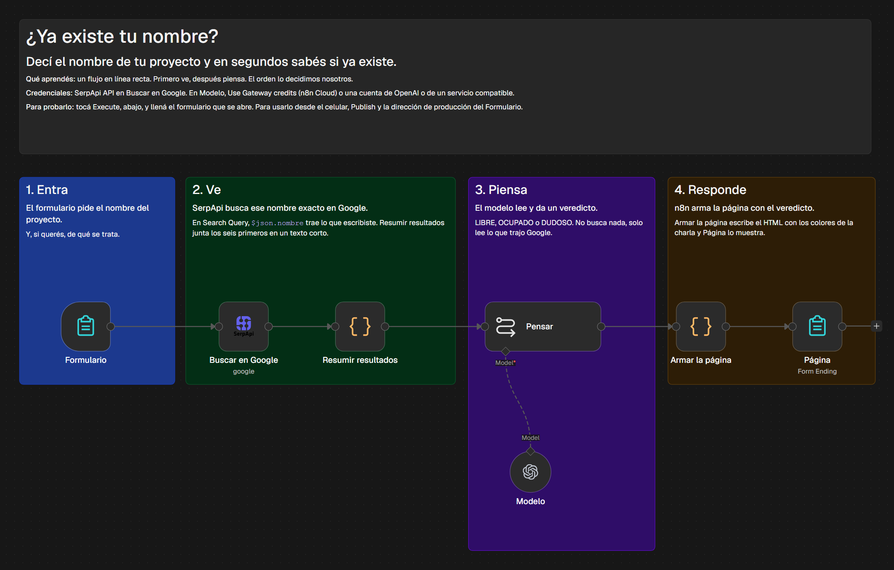
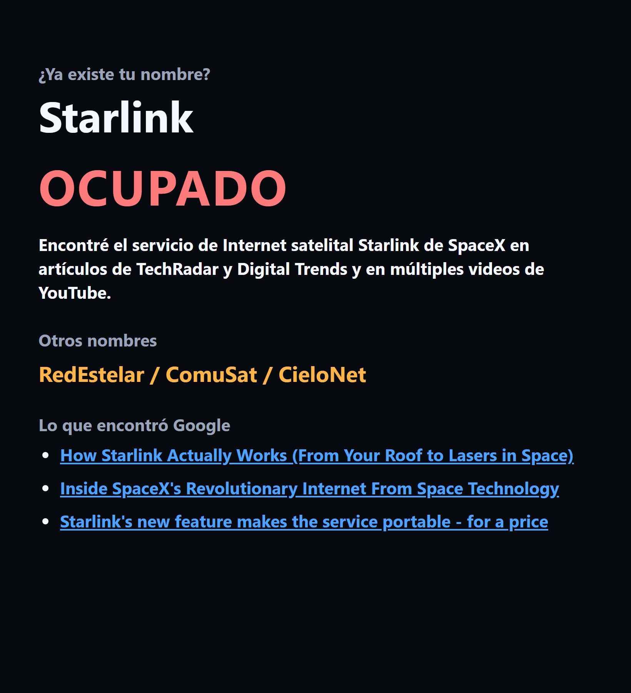
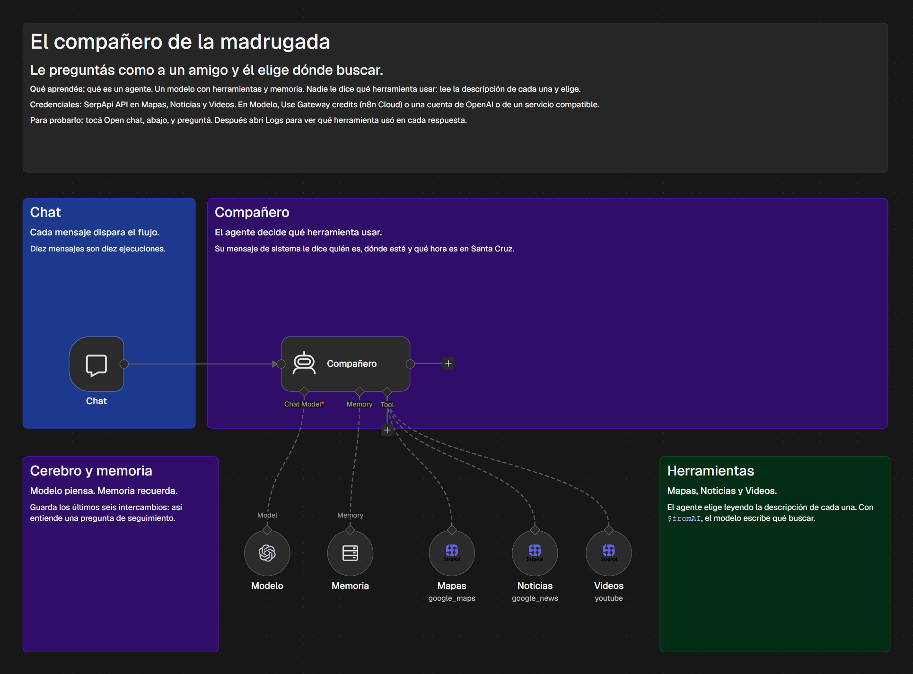
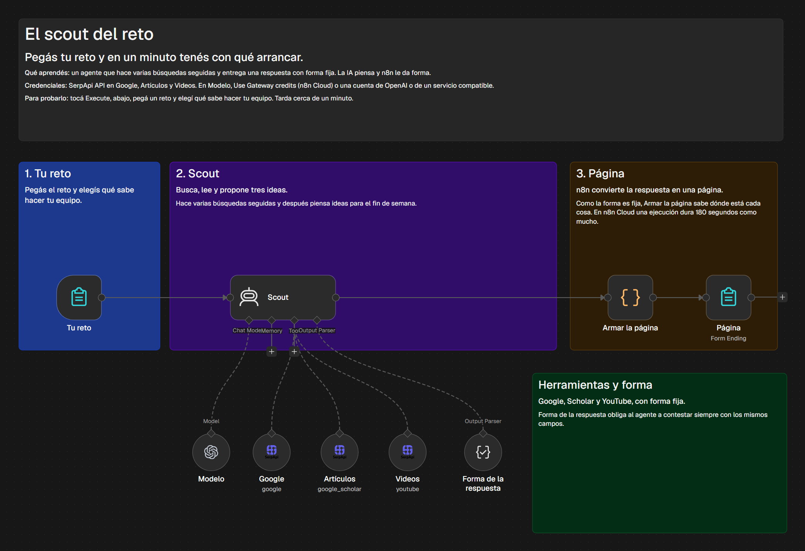
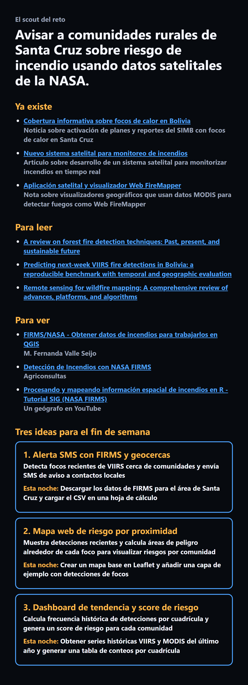
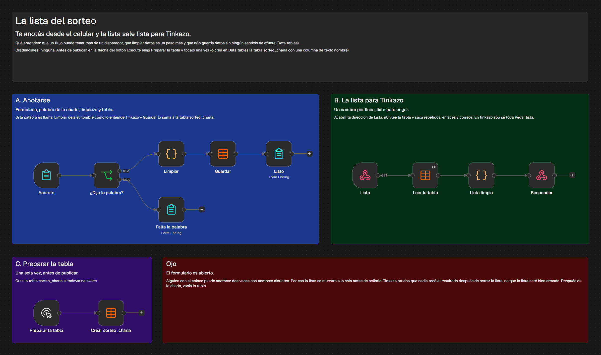

# Los cuatro flujos de la charla

Estos son los workflows de n8n de la charla **Dale superpoderes a tus automatizaciones: n8n + SerpApi + IA**, que se dio en las Space Talks del Hackathon NASA Space Apps 2026, en Santa Cruz de la Sierra, el 14 de noviembre de 2026. Los cuatro se armaron para que los importes, les pongas tus credenciales y los uses esa misma noche.

| # | Flujo | En una frase | Qué aprendés |
|---|---|---|---|
| 1 | [¿Ya existe tu nombre?](1-ya-existe-tu-nombre.json) | Decí el nombre de tu proyecto y en segundos sabés si ya existe. | Un flujo en línea recta: primero ve, después piensa |
| 2 | [El compañero de la madrugada](2-companero-de-la-madrugada.json) | Le preguntás como a un amigo y él elige dónde buscar. | Qué es un agente: herramientas, memoria y un modelo que elige solo |
| 3 | [El scout del reto](3-scout-del-reto.json) | Pegás tu reto y en un minuto tenés con qué arrancar. | Un agente que busca varias veces y responde con forma fija |
| 4 | [La lista del sorteo](4-lista-del-sorteo.json) | Te anotás desde el celular y la lista sale lista para Tinkazo. | Dos disparadores, limpiar datos y guardar en una tabla de n8n |

Cada JSON trae notas adentro del lienzo (la pantalla de n8n donde se arman los flujos) que explican qué hace cada parte, en español. Abrilo y leelo de izquierda a derecha.

Si nunca usaste n8n: un workflow es una fila de bloques, que n8n llama nodos. El primero es el disparador, lo que hace arrancar todo (un formulario, un mensaje de chat, una dirección web). Cada uno de los demás hace una sola cosa y le pasa su resultado al siguiente.

Se probaron de verdad el 14 de noviembre de 2026 en **n8n 2.47.7** (la versión estable de ese día), con el nodo **SerpApi Official 0.1.10**: cada flujo se importó, se publicó y se llamó por su dirección, y los JSON de esta carpeta se exportaron desde ese n8n y se limpiaron (sin credenciales ni datos de la cuenta). Después se importaron en un n8n vacío: con solo elegir las credenciales quedaron listos para publicar ([muestras/prueba-n8n-vacio.json](muestras/prueba-n8n-vacio.json)). Lo que salió de cada flujo está en [muestras/](muestras/).

## Antes de empezar (una sola vez)

### 1. Una cuenta de n8n Cloud

Registrate en **https://app.n8n.cloud/register**. La prueba dura 14 días, no pide tarjeta y trae 1.000 ejecuciones, con 5 a la vez y 180 segundos como mucho por ejecución ([precios](https://n8n.io/pricing/) y [la prueba](https://docs.n8n.io/deploy/use-n8n-cloud/start-your-free-trial)).

Si preferís n8n en tu compu: con Node.js 24 instalado (https://nodejs.org), en una terminal escribís `npx n8n@2.47.7` y abrís http://localhost:5678. Va con el número de versión a propósito: desde n8n 3, que se espera para principios de diciembre de 2026, ya no se instala con `npx` ([cambios de n8n 3](https://docs.n8n.io/changelog/v30-breaking-changes)). Ojo: los Gateway credits (más abajo) son solo de n8n Cloud.

### 2. Instalá SerpApi Official antes de importar

Los flujos 1, 2 y 3 usan el nodo comunitario verificado **SerpApi Official** (paquete `n8n-nodes-serpapi`), que mantiene SerpApi. En el editor abrí el panel de nodos (el botón **+** del lienzo), buscá **serpapi** y, en **More from the community**, instalá SerpApi Official. Lo instala el dueño o un admin de la instancia, y en tu prueba de Cloud el dueño sos vos ([cómo se instala](https://docs.n8n.io/integrations/community-nodes/installation-and-management/install-verified-community-nodes)).

Si importás sin instalarlo, n8n no reconoce esos nodos. En la prueba, publicar así daba `Unrecognized node type: n8n-nodes-serpapi.serpApi`.

No uses el nodo viejo SerpApi (Google Search): está obsoleto desde n8n 2.35.0.

### 3. Tu llave de SerpApi

Registrate en https://serpapi.com/users/sign_up. El plan gratis trae 250 búsquedas por mes y 50 por hora, y una búsqueda igual dentro de la hora sale de la caché y no se cuenta ([precios](https://serpapi.com/pricing)). La llave está en https://serpapi.com/manage-api-key.

En n8n, la primera vez que abras un nodo de SerpApi: en **Credential to connect with**, **Create new credential**, **SerpApi API**, y pegás la llave en **API Key**. Después la elegís en los demás nodos de SerpApi.

### 4. El modelo de IA: tres opciones

Los flujos 1, 2 y 3 traen un nodo chico llamado **Modelo** (OpenAI Chat Model), conectado debajo del nodo que piensa. Es la IA que usa el flujo. Viene con `gpt-5-mini` y con **Use Responses API** apagado (no hace falta tocarlo).

**Opción A, gratis y la más fácil: Use Gateway credits (solo n8n Cloud).** No pide crear otra cuenta ni copiar llaves. Abrí el nodo Modelo y, en el campo de la credencial, elegí **Use Gateway credits**. La prueba de Cloud trae créditos para usar modelos sin llave propia ([Gateway credits](https://docs.n8n.io/deploy/use-n8n-cloud/gateway-credits)). Dejá el modelo en `gpt-5-mini`. Cuánto rinden los créditos depende del modelo: mirá el saldo en el mismo campo. Si en tu nodo no aparece esa opción, o se te acabaron los créditos, seguí con la opción B o la C.

**Opción B, la que se usó para probar estos flujos: OpenRouter con tu llave.** Creá una llave en https://openrouter.ai/keys. En el nodo Modelo, **Create new credential**, **OpenAI**: en **API Key** pegás la llave de OpenRouter y en **Base URL** ponés `https://openrouter.ai/api/v1`. En **Model** elegí **By ID** y escribí `openai/gpt-5-mini`. Esta fue la configuración de todas las pruebas de esta carpeta.

Ojo: `openai/gpt-5-mini` en OpenRouter es pago (el 13 de noviembre de 2026 costaba 0,25 dólares por millón de tokens de entrada y 2 dólares por millón de salida, y un token es un pedazo de palabra, según https://openrouter.ai/api/v1/models). Con una cuenta nueva y sin saldo, el nodo da error. Gratis en OpenRouter: un modelo cuyo ID termina en `:free` que acepte herramientas, por ejemplo `google/gemma-4-31b-it:free`, con 20 pedidos por minuto y 50 por día si compraste menos de 10 créditos ([límites](https://openrouter.ai/docs/api-reference/limits)). La lista de modelos gratis cambia seguido.

**Opción C, una llave gratis de Google.** Creala en https://aistudio.google.com/apikey. Después borrá el nodo Modelo, tocá el **+** que queda libre debajo del nodo que piensa y elegí **Google Gemini Chat Model**, con una credencial nueva donde pegás la llave. El resto del flujo no cambia. En la capa gratis de Gemini, Google usa lo que mandás para mejorar sus productos: nada de datos personales.

Los flujos 2 y 3 traen en el Modelo la opción **Reasoning Effort** en **Low**, para que respondan más rápido (en la prueba, el flujo 3 bajó de unos 75 a 46 segundos). Sirve para los modelos que razonan, como `gpt-5-mini`. Si elegís otro modelo y da un error que nombra `reasoning_effort`, abrí **Options** en el Modelo y sacala.

## Cómo importar un flujo

1. Bajá el JSON de esta carpeta. En GitHub, abrí el archivo y tocá **Download raw file**, o bajá todo el repositorio con **Code** y **Download ZIP**.
2. En n8n, creá un workflow nuevo. En el menú de arriba a la derecha (los tres puntos), **Import from File**, y elegí el JSON. También podés copiar el contenido del archivo y pegarlo en el lienzo con Ctrl + V.
3. Los nodos que piden credencial se marcan con un aviso. Abrí cada uno y elegí la credencial: SerpApi API en los de SerpApi y la del Modelo (opción A, B o C).
4. Probalo con el botón de abajo (**Execute** o **Open chat**).
5. Para que funcione desde otro dispositivo, **Publish** arriba a la derecha. Desde n8n 2.0 se publica en lugar de activar, y recién ahí los formularios y webhooks usan su dirección de producción ([publicar](https://docs.n8n.io/build/understand-workflows/save-and-publish-workflows)).

## 1. ¿Ya existe tu nombre?



**Qué hace.** Un formulario pide el nombre de tu proyecto. SerpApi lo busca en Google entre comillas, un nodo Code junta los seis primeros resultados, el modelo los lee y da un veredicto (LIBRE, OCUPADO o DUDOSO) con tres nombres alternativos, y n8n te devuelve una página con el veredicto y los enlaces.

**Qué aprendés.** Un flujo en línea recta: disparador, ver, pensar y responder. El orden lo decidiste vos. Las expresiones (por ejemplo `$json.nombre` en la búsqueda) llevan el dato de un nodo al siguiente. El modelo no busca nada: lee lo que trajo Google, y eso se nota en que cita lo que encontró.

**Credenciales.** SerpApi API en **Buscar en Google**. La del modelo en **Modelo**.

**Probalo en un minuto.** **Execute**, se abre el formulario, escribí un nombre y tocá **Buscar**. Unos segundos después aparece la página. Publicado, el formulario queda en `https://<tu-instancia>/form/ya-existe`.

**Así salió en la prueba** ([muestras/flujo1-satelitazo.json](muestras/flujo1-satelitazo.json) y [muestras/flujo1-starlink.json](muestras/flujo1-starlink.json), cerca de 11 segundos cada uno):

| Nombre | Veredicto | Por qué (lo que respondió el modelo) | Otros nombres |
|---|---|---|---|
| Satelitazo | LIBRE | No apareció ningún resultado con el nombre "Satelitazo", los resultados muestran artículos y definiciones generales sobre satélites en sitios como Servnet, Diario Extra, 2001 Online, Adobe Stock y El Comercio | PasaSat, SatAviso, OrbitaYa |
| Starlink | OCUPADO | Encontré el servicio de Internet satelital Starlink de SpaceX en artículos de TechRadar y Digital Trends y en múltiples videos de YouTube. | RedEstelar, ComuSat, CieloNet |



Gasta una búsqueda de SerpApi por nombre. El mismo nombre dentro de la hora no gasta.

## 2. El compañero de la madrugada



**Qué hace.** Un chat con un agente que tiene tres herramientas de SerpApi: **Mapas** (Google Maps, centrado en Santa Cruz de la Sierra), **Noticias** (Google News para Bolivia) y **Videos** (YouTube en español), más una memoria de los últimos seis intercambios.

**Qué aprendés.** Qué es un agente. Nadie le dice qué herramienta usar: lee la descripción de cada una (el campo Description de la herramienta) y elige. En el campo de búsqueda de cada herramienta, `$fromAI(...)` deja que el modelo escriba qué buscar. La memoria hace que una pregunta de seguimiento funcione sin repetir el contexto.

**Credenciales.** SerpApi API en **Mapas**, **Noticias** y **Videos**. La del modelo en **Modelo**. La **Memoria** no pide nada.

**Probalo en un minuto.** **Open chat**, abajo, y escribí una pregunta. Después abrí **Logs** para ver qué herramienta usó en cada respuesta. Cada mensaje es una ejecución.

**Así salió en la prueba**: cuatro preguntas seguidas en la misma conversación, a las 2:21 de la madrugada del 14 de noviembre de 2026 ([muestras/flujo2-conversacion.json](muestras/flujo2-conversacion.json), con las respuestas completas y lo que devolvió cada búsqueda):

| Pregunta | Qué eligió | Primer renglón de la respuesta | Segundos |
|---|---|---|---|
| Somos cuatro y necesitamos un café abierto cerca del centro. ¿Dónde vamos? | Mapas | No hay cafés abiertos ahora en el centro. (Después nombra tres, con su puntaje y a qué hora abren.) | 21,5 |
| ¿Qué noticias hay de la NASA esta semana? Decime la fecha de cada una. | Noticias | 10 de noviembre: La NASA busca a la próxima generación de astronautas. Fuente: NASA. | 29,8 |
| Pasame un video corto en español para aprender n8n. | Videos | Te paso uno corto para empezar con n8n. (Después da el título, el canal y el enlace.) | 20,0 |
| De esos cafés, ¿cuál tiene mejor puntaje? | Ninguna: usó la memoria | Cofi Centro, 4.7, 153 reseñas. | 8,2 |

Lo que responda depende del día y de la hora: las noticias y los lugares son los de ese momento, y a las 2 de la mañana los cafés estaban cerrados. El agente solo usa lo que devolvieron las herramientas.

**Una lección de las pruebas: pedile la fecha.** En un ensayo anterior, el agente buscó NASA hoy y Google News devolvió notas de febrero, de marzo y de principios de noviembre con la palabra hoy en el título. El agente las contó como si fueran de ese día. Por eso el mensaje de sistema le pide decir la fecha de cada noticia y no decir hoy si no es de hoy, y la herramienta le pide buscar sin palabras como hoy. Google News da la fecha como mes/día/año.

Gasta de una a dos búsquedas por pregunta. Las de seguimiento, a veces ninguna.

## 3. El scout del reto



**Qué hace.** Un formulario pide el reto que eligió tu equipo y qué sabe hacer (Web, Apps, Datos, Hardware o Diseño). Un agente busca con tres herramientas, una vez cada una: **Google** (qué ya existe), **Artículos** (Google Scholar, en inglés) y **Videos** (tutoriales en YouTube). Después propone tres ideas para un fin de semana, cada una con un primer paso para esa noche. n8n arma una página con todo.

**Qué aprendés.** Un agente que hace varias búsquedas seguidas y una **salida con forma fija**: el nodo **Forma de la respuesta** (Structured Output Parser) obliga al agente a contestar siempre con los mismos campos, y por eso un nodo Code puede convertir la respuesta en una página. La IA piensa y n8n le da forma.

**Credenciales.** SerpApi API en **Google**, **Artículos** y **Videos**. La del modelo en **Modelo**.

**Probalo en un minuto.** **Execute**, pegá un reto, elegí qué sabe hacer tu equipo y tocá **Investigar**. En la prueba tardó 46 segundos. En n8n Cloud una ejecución puede durar 180 segundos como mucho.

**Así salió en la prueba** ([muestras/flujo3-incendios.json](muestras/flujo3-incendios.json) y la página en [muestras/flujo3-incendios.html](muestras/flujo3-incendios.html)). El reto lo escribimos para la demo, no es un reto oficial del hackathon:

- **Reto:** Queremos avisar a las comunidades rurales de Santa Cruz cuando hay riesgo de incendio cerca, usando datos de satélites de la NASA. Equipo: Datos.
- **El reto en una frase:** Avisar a comunidades rurales de Santa Cruz sobre riesgo de incendio usando datos satelitales de la NASA.
- **Encontró** 3 cosas que ya existen, 3 artículos para leer y 3 videos, todos con su enlace.
- **Las tres ideas:** Alerta SMS con FIRMS y geocercas. Mapa web de riesgo por proximidad. Dashboard de tendencia y score de riesgo.
- **Primer paso de la primera idea:** Descargar los datos de FIRMS para el área de Santa Cruz y cargar el CSV en una hoja de cálculo.



Gasta tres búsquedas por reto.

## 4. La lista del sorteo



**Qué hace.** Tres ramas en un mismo workflow:

- **A. Anotarse.** Un formulario pide tu nombre y apellido, o un apodo, y la palabra de la charla (en la charla fue **llama**). Si la palabra está bien, el nombre se limpia como lo entiende Tinkazo y se guarda en la tabla `sorteo_charla`. Si no, el formulario lo dice.
- **B. La lista para Tinkazo.** Una dirección web (un webhook) que, al abrirla, lee la tabla, saca repetidos (aunque cambien mayúsculas o tildes), enlaces y correos, y responde solo texto: un nombre por línea. Se copia todo y en https://tinkazo.app se toca **Pegar lista**. Como saca repetidos, si dos personas se anotan como Ana queda una sola: por eso el formulario pide nombre y apellido, o un apodo que nadie más use.
- **C. Preparar la tabla.** Se corre una sola vez: crea la tabla si todavía no existe.

**Qué aprendés.** Que un flujo puede tener más de un disparador, que limpiar datos es un paso más y que n8n guarda datos sin ningún servicio de afuera ([Data tables](https://docs.n8n.io/build/work-with-data/data-tables)).

**Credenciales.** Ninguna.

**Probalo en un minuto.**

1. En la flecha del botón **Execute** elegí **Preparar la tabla** y tocalo una vez. Crea la tabla `sorteo_charla` con una columna de texto `nombre`. También la podés crear a mano en la pestaña **Data tables**.
2. **Publish**. El formulario queda en `https://<tu-instancia>/form/sorteo-space-apps` y la lista en `https://<tu-instancia>/webhook/lista-sorteo-space-apps`.
3. Anotate dos o tres veces desde el celular y abrí la dirección de la lista.

**Así salió en la prueba** ([muestras/flujo4-anotaciones.json](muestras/flujo4-anotaciones.json)): doce anotaciones con repetidos, mayúsculas, tildes, una coma, un nombre de una letra, un enlace, un correo, un carácter invisible, uno vacío y uno de más de 40 letras, más una con la palabra mal. La lista salió así ([muestras/flujo4-lista.txt](muestras/flujo4-lista.txt)):

```text
Ana
Beto
Nora la de Tarija
Lucas
Un nombre larguísimo que pasa de cuarent
Ñandú
```

El formulario es abierto: alguien con el enlace puede anotarse dos veces con nombres distintos. Por eso la lista se muestra a la sala antes de sellarla en Tinkazo. Tinkazo prueba que nadie tocó el resultado después de cerrar la lista, no que la lista esté bien armada. Después del sorteo, vaciá la tabla.

## Si algo no anda

| Lo que ves | Qué hacer |
|---|---|
| `Missing required credential` al publicar | Falta elegir la credencial en ese nodo. |
| `Unrecognized node type: n8n-nodes-serpapi...` | Falta instalar SerpApi Official (paso 2). |
| El Modelo da un error que nombra `reasoning_effort` | En el Modelo, **Options**, sacá **Reasoning Effort**. |
| El Modelo da un error de saldo o de pago con OpenRouter | `openai/gpt-5-mini` es pago. Cargá saldo o elegí un modelo `:free` (paso 4). |
| En el Modelo no aparece **Use Gateway credits** | Es solo de n8n Cloud. Usá la opción B o la C (paso 4). |
| `Data table with name "sorteo_charla" not found` | Corré **Preparar la tabla** (flujo 4, paso 1). |
| La lista del sorteo sale vacía | Todavía no se anotó nadie con la palabra correcta. |
| SerpApi dice que no quedan búsquedas | El plan gratis trae 250 por mes y 50 por hora. |

## Qué hay en esta carpeta

- Los cuatro JSON, listos para importar.
- [muestras/](muestras/): entradas y salidas reales de las pruebas. Los `flujo*.json` resumen cada prueba (entrada, qué buscó, qué respondió y cuánto tardó). Los `flujo*.html` son las páginas que devolvieron los flujos 1 y 3, y se abren sin internet. Los `serpapi-*.json` son respuestas de SerpApi tal como llegaron a n8n.
- [capturas/](capturas/): los cuatro lienzos, los formularios y las páginas de resultado.
- [ESPEC.md](ESPEC.md): la especificación nodo por nodo y lo que cambió al probarla.

n8n y SerpApi son marcas de sus dueños. Los flujos usan sus nodos oficiales tal como vienen.
